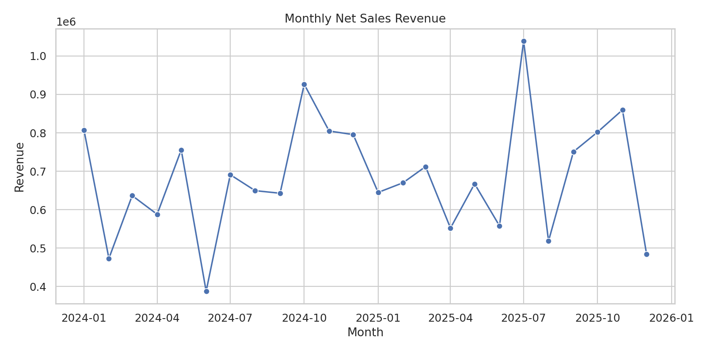
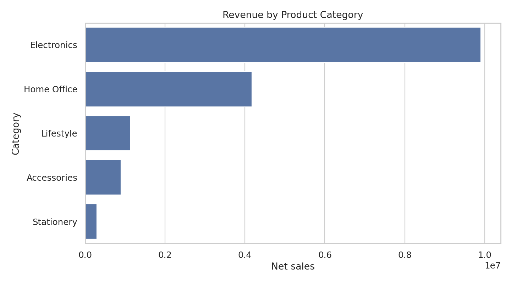

# E-Commerce Sales Analysis (Python)

## Business question
Which products, categories, months and customers contribute most to sales, and what does the order funnel look like?

## Stack
Python 3.10+, pandas, NumPy, Matplotlib and Seaborn.

## Dataset
The `data/` folder contains deterministic, synthetic sample data for customers, products, orders, order items and payments. It contains no real customer information. Monetary values are illustrative Indian-rupee-like amounts and are not real commercial records.

## Run it
From this folder:

```bash
python -m pip install -r ../../requirements.txt
python -m src.analyze
```

The script validates key relationships, calculates net sales for shipped/delivered orders, and writes CSV summaries, charts and `outputs/summary.txt` into `outputs/`.

## Main analysis
- Revenue, order count and average order value.
- Monthly revenue trend.
- Revenue by category and top products.
- Top customers by net sales.

## Portfolio questions to extend
1. Compare repeat-customer and first-time-customer revenue.
2. Calculate cancellation and return rates by month.
3. Add a cohort-retention analysis based on customer signup month.
4. Explain how discounting affects units sold and net revenue.

## Limitations
This is a synthetic portfolio dataset. Results demonstrate analytical workflow, not actual market behavior or causal findings.

## Sample run (synthetic data)
The included sample run produced approximately **16.42M** in net revenue across **1,661** shipped or delivered orders, with an average order value of **9,884.69**. Electronics was the highest-revenue category in this generated sample. These figures are outputs of the synthetic generator, not real commercial metrics.

### Chart previews



